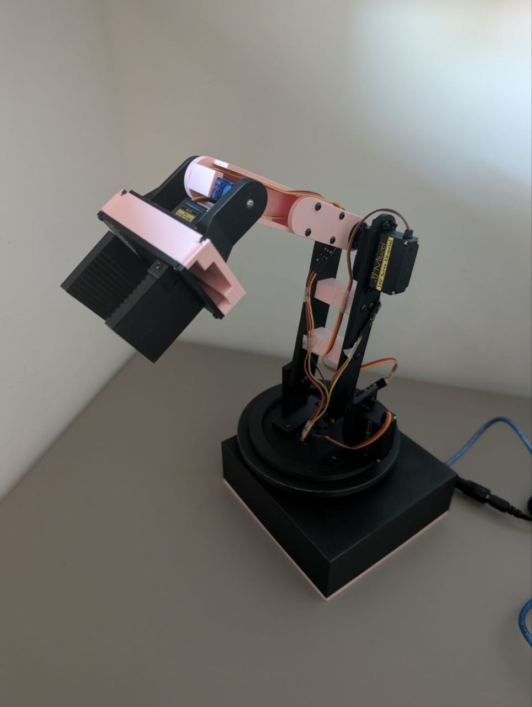
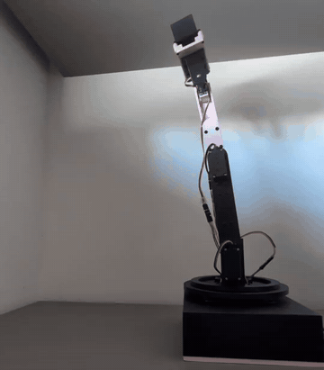
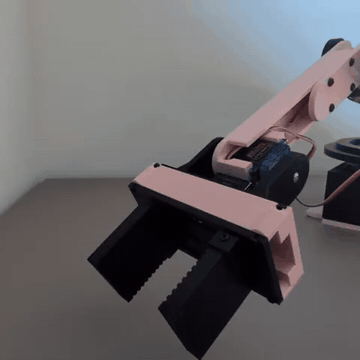
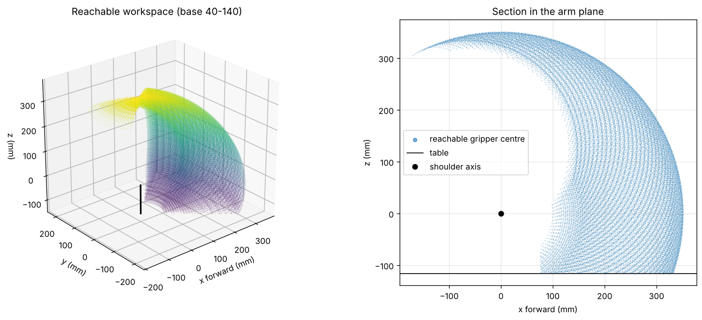

# Marco Arm

<p align="center">
  
</p>

<p align="center">
  
  
</p>

I come from mechanical engineering and I am moving toward robot learning. I wanted a platform of my own to try control ideas on, one I could break, fix and learn from, so I built Marco starting from an empty CAD file.

Marco is a 4-DoF arm with a parallel gripper, 3D-printed and driven by hobby servos, meant to stay simple and well documented. This repository contains the CAD, the firmware, the Python control code and the calibration of the real arm.

## Overview

| | |
|---|---|
| Joints | Rotating base; shoulder, elbow and wrist in one vertical plane; parallel gripper |
| Link lengths | 140 mm shoulder–elbow, 140 mm elbow–wrist, 71 mm wrist–gripper centre |
| Actuators | 3 × MZ996 servos (15 kg·cm, metal gears) for base, shoulder, elbow; 2 × SG90 for wrist and gripper |
| Electronics | Arduino Uno (clone) + PCA9685 servo driver over I²C, separate 5 V 10 A supply |
| Control | Serial commands from Python; gamepad teleoperation |
| Structure | 3D-printed PLA parts (Bambu Lab A1 Mini) |

## Status

| Stage | Content | Status |
|---|---|---|
| 1 | Mechanical design, printing and assembly | Done |
| 2 | Electronics and firmware: per-joint speed ramps, neutral pose, joint limits | Done |
| 3 | Control from Python over serial, gamepad teleoperation | Done |
| 4 | Calibration: command-to-angle map per joint, forward kinematics check, shoulder stall torque, workspace | Done |
| 5 | Inverse kinematics in the arm plane | Next |
| 6 | Null-space motion on the real arm: joints move, the hand stays still | Planned |
| 7 | Joint position feedback from the servo potentiometers | Planned |

## Design

**Base.** A box holds the base servo and the electronics, with a 4" lazy susan bearing the turntable plate. The servo horn is screwed to the underside of the plate; the arm cables pass through arc-shaped slots that follow the plate holes as it turns. The box clamps to the desk.

**Shoulder.** Link 1 is a U between the servo horn on one side and a 625ZZ bearing on an M5 pin on the other, so the link is supported on both sides instead of hanging on the servo shaft.

**Forearm, wrist and gripper.** The forearm carries the wrist SG90 in a cradle; the gripper is a rack-and-pinion mechanism with parallel fingers, designed for this arm.

**Firmware.** `pca_serial` receives `channel angle` lines, moves each joint with its own speed ramp, rejects angles outside each joint's range and replies when the move is over. At power-up every joint goes to a neutral pose.

**Python.** `marco.py` wraps the serial protocol (`open_arm`, `move_joint`) and holds the joint limits and the calibration, with conversions between servo commands and real joint angles. `gamepad_arm.py` maps an Xbox-style controller to the joints with excavator-style controls: the sticks set the speed of each joint, the buttons open and close the gripper.

## Calibration

Hobby servos do not turn exactly as commanded, so each joint was measured on the real arm. Shoulder, elbow and wrist angles were read with a phone inclinometer at three to five commands per joint; the base angle from marks on the turntable rim, measured with a caliper. Where possible, points were approached from the same side, so that backlash does not enter the fit.

| Joint | Real angle (c = servo command, deg) | Fit error | Accepted range |
|---|---|---|---|
| Base | ψ = 0.754 · (c − 90), counterclockwise seen from above | 0.7° | 40–140 |
| Shoulder | θ = 0.865 · c − 30.1, link 1 from the table | 0.7° | 10–170 |
| Elbow | q2 = 0.836 · c − 143.0, forearm from link 1 | 0.8° | 10–170 |
| Wrist | q3 = −0.910 · c + 49.4, gripper from forearm | 0.1° | 40–110 |
| Gripper | – | – | 30–150 |

- **Forward kinematics check.** With the calibrated angles, the predicted wrist position matched the measured one within 2 mm.
- **Backlash.** About 1° on most joints, 2–3° at the base, and about 7° when a link passes vertical and gravity changes side.
- **Servo horn indexing.** The elbow horn is mounted 4 teeth (about 58°) and the wrist horn 2 teeth (about 36°) away from the mid-travel position, so that the limited servo travel is spent where the arm works: in front of the base and down to the table. As a trade-off the elbow no longer straightens fully (q2 ≤ −1°).
- **Shoulder stall torque at 5 V.** With the arm horizontal and a load hung at the elbow, the shoulder held about 14.6 kg·cm; at a higher load the horn slipped one tooth on the spline.

## Workspace



The gripper centre reaches a thick arc in front of the arm. On the table it reaches from the edge of the turntable to about 34 cm from the shoulder axis; with the gripper pointing down (top-down grasp), from 9 to 27 cm. The map is computed from the calibration above and the forward kinematics, over every servo command inside the firmware limits.

## Repository structure

| Folder | Content |
|---|---|
| `cad/` | Print files (`stl/`), parts in the arm frame (`step/`), part sources (`scripts/`) |
| `firmware/` | `pca_serial`: the sketch that drives the arm |
| `python/` | `marco.py` (serial interface, limits, calibration), `demo.py` (three moves), `gamepad_arm.py` (whole arm), `gamepad_test.py` (controller check) |
| `media/` | Photos and animations |

## Usage

1. Upload `firmware/pca_serial` to the Arduino (Adafruit PWM Servo Driver library). At power-up the arm goes to its neutral pose.
2. Serial Monitor at 9600 baud, line ending "New Line": `2 70` moves the elbow (channel 2) to 70°. Channels: 0 base, 1 shoulder, 2 elbow, 3 wrist, 4 gripper.
3. From Python:

```bash
cd python
pip install -r requirements.txt

# three joints, one after the other, with the arm's replies
python demo.py --port COM3

# the whole arm from an Xbox-style controller (Start to stop)
python gamepad_arm.py --port COM3
```

Close the Arduino Serial Monitor first: only one program can use the port.

## Known issues

- **Base servo horn engagement.** With the printed servo pads, the base servo shaft enters the horn only partly. On the built arm the horn is pushed fully onto the shaft and held by its centre screw; raising the pads in the base design would remove the need for it.
- **Wrist servo.** The SG90 at the wrist buzzes slightly while holding a pose and above 110 or below 40 on the servo command; a metal-gear servo of the same size would fix it.

## Next steps

- Inverse kinematics in the arm plane, using the calibration above.
- Null-space motion on the real arm, on video.
- Joint position feedback from the potentiometer inside each servo.
- Projects on top of the arm: target tracking with a camera (OpenCV), teleoperation with a hand in front of a webcam (MediaPipe), and policies trained in simulation (sim-to-real RL).

## License

Software (`firmware/`, `python/`): [MIT](LICENSE). Hardware design (`cad/`): [CC BY-SA 4.0](LICENSE-CAD.md).
